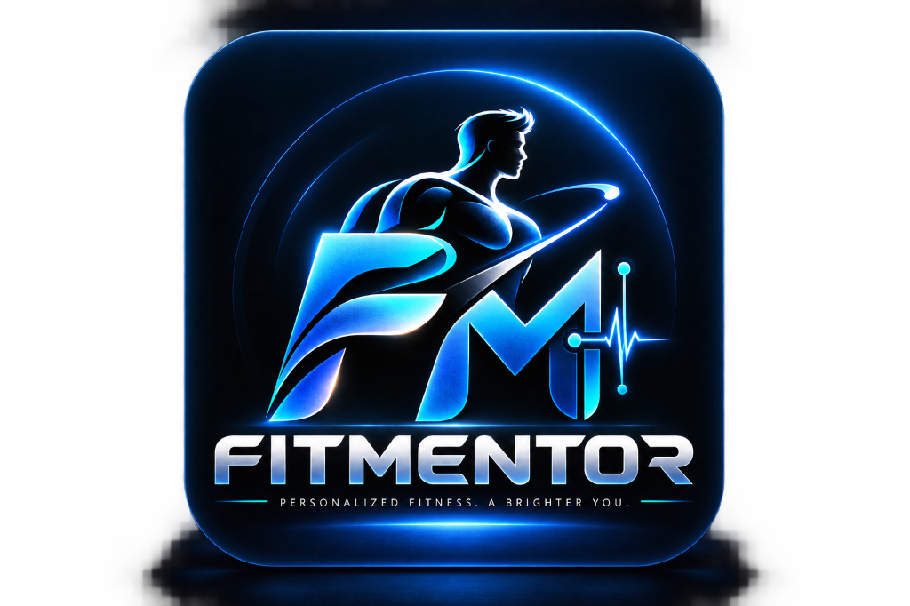

# ⚔️ FitMentor AI — Solo Leveling-Inspired Fitness RPG & Biomechanics Platform
link : https://fit-mentor-ai.onrender.com/
<p align="center">
  
</p>

<p align="center">
  <b>A production-ready, full-stack fitness RPG platform fusing athletic science, 3D biomechanics, and Solo Leveling hunter progression.</b>
</p>

<p align="center">
  <a href="https://github.com/G-Sukumar/Fit-Mentor-Ai"></a>
  <a href="https://react.dev/"></a>
  <a href="https://expressjs.com/"></a>
  <a href="https://www.postgresql.org/"></a>
  <a href="#"></a>
</p>

---

## 🌟 Executive Overview

**FitMentor AI** transforms standard workout routines into an interactive, gamified hunter progression system. Designed with the high-fidelity **Kinetic Horizon** aesthetic (Solo Leveling monarch blues, royal purples, and neon energy), it combines:
1. **Solo Leveling RPG Progression**: Level 1 (Rank E Novice) to Level 75+ (Shadow Monarch), deterministic XP tracking, anti-cheat idempotency, Hunter Badges, and tiered anime Monarch Avatars.
2. **3D Biomechanical Kinematics**: Interactive Three.js procedural athlete viewer with camera switching (Front, Side, Isometric), phase indicators (Concentric/Eccentric), muscle target heatmaps, and RepDB cues.
3. **Autoregulation Engine**: Real-time set calibration using the **Epley e1RM formula**, Reps In Reserve (RIR), and Rating of Perceived Exertion (RPE) to dynamically prescribe weight and rest adjustments.
4. **AI Sports Science Coach**: Context-aware conversational assistant providing biomechanical corrections and adaptive recovery advice.

---

## 📁 Repository & Folder Structure

The repository is organized into distinct, modular subsystems designed for clarity and rapid maintainability:

```text
Fit-Mentor-Ai/
├── 🌐 frontend/                 # React 18 + Vite + Tailwind CSS Single-Page Application
│   ├── public/                 # Static assets, logos, and shader canvas resources
│   │   ├── images/             # Solo Leveling monarch artwork & avatars
│   │   ├── logo.png            # FitMentor brand badge
│   │   └── particle_cloak.html # WebGL particle background canvas
│   ├── src/
│   │   ├── components/         # Modular UI Component Library
│   │   │   ├── dashboard/      # Daily telemetry, intake, and recommended workout cards
│   │   │   ├── layout/         # AppShell, Navigation Drawer, and Top Bar
│   │   │   ├── navigation/     # Header, Sidebar, and ProtectedRoute guards
│   │   │   ├── progression/    # Hunter Armory, Level-Up Modals, and XP Bars
│   │   │   ├── ui/             # Hunter Avatars, Badges, and WebGL Canvas wrappers
│   │   │   └── workout/        # Active Workout Workspace, 3D Canvas, Set Logger & Rest Timer
│   │   ├── config/             # Exercise 3D registry, muscle groupings, and visual assets
│   │   ├── context/            # AuthContext (JWT session state & user profile)
│   │   ├── data/               # Seed metadata, RepDB image mappings, and exercises
│   │   ├── hooks/              # Custom React hooks (useExercise3DScene, useTimer)
│   │   ├── pages/              # Primary Route Views:
│   │   │   ├── Dashboard.tsx   # Hunter Status, daily quests, and training overview
│   │   │   ├── Workout.tsx     # Active session, 3D Kinematics Studio, and set logging
│   │   │   ├── Progress.tsx    # Hunter rank ascension, XP metrics, and milestone history
│   │   │   ├── AICoach.tsx     # Sports science conversational mentor
│   │   │   ├── Nutrition.tsx   # Caloric distribution & hydration tracker
│   │   │   ├── Wearables.tsx   # Biometric device telemetry integration
│   │   │   └── Login.tsx       # Hunter authentication portal
│   │   ├── services/           # Typed REST API Client & Progression sync engine
│   │   └── types/              # Full TypeScript interface definitions
│   ├── package.json            # Frontend dependencies & build scripts
│   ├── tailwind.config.js      # Kinetic Horizon theme & custom animations
│   ├── tsconfig.json           # Strict TypeScript configuration
│   ├── vercel.json             # Vercel SPA routing rewrite configuration
│   └── vite.config.ts          # Vite build pipeline & local API proxy
│
├── ⚙️ backend/                  # Node.js + Express + TypeScript Production REST API
│   ├── src/
│   │   ├── __tests__/          # Automated Test Suites (Progression & Adaptive Engine)
│   │   ├── config/             # Environment loader, DB connection pool & SQL migrator
│   │   ├── controllers/        # Express Route Handlers (Auth, Workouts, Progression, Profile)
│   │   ├── middleware/         # JWT verification, CORS policy & error handling
│   │   ├── routes/             # REST endpoint routing tables (/api/*)
│   │   ├── services/           # Core Business Logic & Adaptive Rule Engine
│   │   ├── types/              # Backend data contracts & DTO models
│   │   ├── utils/              # Mathematical formulas (Epley, RIR, RPE) & structured logger
│   │   └── server.ts           # Server bootstrap, static SPA resolver & healthcheck
│   ├── package.json            # Backend dependencies (Express, pg, bcryptjs, jsonwebtoken)
│   └── tsconfig.json           # TypeScript build targets
│
├── 🗄️ database/                 # Relational PostgreSQL Database Engine
│   ├── migrations/             # Sequential SQL Schemas (001_initial through 005_progression)
│   ├── seeds/                  # Baseline exercises, workout templates, and quests
│   └── README.md               # Database dictionary & connection guides
│
├── 🧠 ml/                       # Machine Learning Recommendation Engine (Python 3.12)
│   ├── data/                   # Workouts catalog & feature vectors
│   ├── src/
│   │   ├── evaluation/         # Recommender metrics & scoring algorithms
│   │   ├── features/           # Feature engineering & user profile vectorizer
│   │   ├── preprocessing/      # Data normalization & categorical encoders
│   │   └── recommendation/     # Collaborative filtering & similarity matrices
│   ├── requirements.txt        # Python ML dependencies (numpy, pandas, scikit-learn)
│   └── main.py                 # Fast ML inference entry point
│
├── 🎨 design/                   # UI/UX Specifications & Theme Tokens
│   ├── DESIGN.md               # Kinetic Horizon color palettes, typography & components
│   └── stitch.config.json      # Google Stitch design system integration
│
├── 📚 documentation/            # Architectural Blueprints & Engineering Whitepapers
│   ├── AIML.md                 # Machine Learning architecture & feature embeddings
│   ├── API.md                  # Comprehensive REST API endpoint reference
│   ├── Database.md             # PostgreSQL ERD schemas & table relationships
│   ├── Features.md             # Functional capability breakdown
│   ├── Modules.md              # System sequence flows & lifecycle diagrams
│   └── ReadinessModel.md       # Physiological readiness algorithm specification
│
├── 🐳 Deployment & Containerization
│   ├── Dockerfile              # Multi-stage production container (Alpine runtime)
│   ├── docker-compose.yml      # Orchestrated PostgreSQL + Full-Stack App deployment
│   ├── render.yaml             # 1-Click Render Cloud Blueprint
│   └── DEPLOYMENT.md           # Deployment runbook (Render, Docker, Railway, Vercel)
│
├── package.json                # Root monorepo orchestration scripts
├── .env.example                # Canonical production environment configuration template
├── .gitignore                  # Production Git ignore rules (node_modules, dist, secrets)
└── README.md                   # Master project documentation
```

---

## ⚡ Quick Start & Local Setup

### Prerequisites
- **Node.js**: v18.0 or higher
- **npm**: v9.0 or higher
- **PostgreSQL**: v14+ *(optional: the server automatically falls back to in-memory mode if DB is offline)*

### Installation

```bash
# 1. Clone the repository
git clone https://github.com/G-Sukumar/Fit-Mentor-Ai.git
cd Fit-Mentor-Ai

# 2. Install dependencies across root, backend, and frontend
npm run install:all

# 3. Launch both backend and frontend concurrently in development mode
npm run dev
```

- **Frontend Application**: `http://localhost:5173`
- **Backend API Gateway**: `http://localhost:5000/api`
- **Health Check Probe**: `http://localhost:5000/health`

---

## 🧪 Automated Test Verification

FitMentor AI includes comprehensive automated test runners ensuring mathematical precision and progression integrity:

```bash
# Run all automated test suites
npm test
```

### Verified Test Results (30 / 30 Passed — 100%):
- **15 / 15 Progression Tests**: Novice start at Level 1 / Rank E, XP idempotency (no duplicate claim exploit), anti-tamper rewards, and Monarch Avatar tier unlocks.
- **15 / 15 Autoregulation Tests**: Epley e1RM calculations, RIR to RPE conversions, fatigue-based load reduction (-10%), and rest-period extensions (+30s to +45s).

---

## 🚀 Production Deployment Options

FitMentor AI supports both unified single-server deployment and split cloud deployment:

| Mode | Platform | Deployment Strategy |
| :--- | :--- | :--- |
| **1-Click Blueprint** | **Render** | Connect repository and apply `render.yaml` (auto-provisions web service + managed PostgreSQL) |
| **Containerized** | **Docker** | Run `docker compose up -d --build` on any Linux VPS (AWS, DigitalOcean, Hetzner) |
| **PaaS** | **Railway** | Connect repo, add PostgreSQL service, set build to `npm run install:all && npm run build` |
| **Split Cloud** | **Vercel + Cloud DB** | Deploy `frontend` on Vercel (SPA routing via `vercel.json`) and `backend` on Render/Railway |

Full instructions are available in [DEPLOYMENT.md](DEPLOYMENT.md).

---

## 🛡️ License & Acknowledgements

Created with ❤️ by [G-Sukumar](https://github.com/G-Sukumar). Built for athletes, lifters, and hunters striving to break their physical limits.
