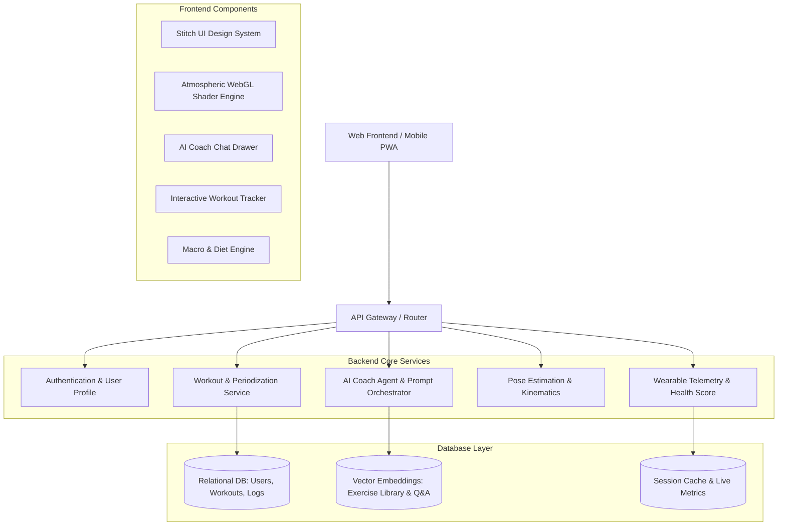

# FitMentor AI — System Architecture & Modules

## Module Breakdown

1. **Authentication & Profile Module**: Manages JWT user tokens, profile preferences, physical stats (height, weight, age, body fat %), and experience level.
2. **Workout Programming Module**: Generates progressive overload schedules, exercise substitutions, and stores historical volume load.
3. **AI Coach Intelligence Module**: Powered by Gemini / LLM with specialized system prompts, grounding with sports science literature, and context injection of recent workouts and recovery state.
4. **Computer Vision & Kinematics Module**: Analyzes live video stream landmarks (shoulders, elbows, wrists, hips, knees, ankles) to evaluate form symmetry and range of motion.
5. **Biometrics & Wearables Module**: Aggregates heart rate, steps, active energy burned, and sleep stages to calculate the composite Daily Readiness Score.
6. **Nutrition Engine Module**: Computes Total Daily Energy Expenditure (TDEE) and dynamically recalibrates daily macro goals based on actual energy expenditure.
